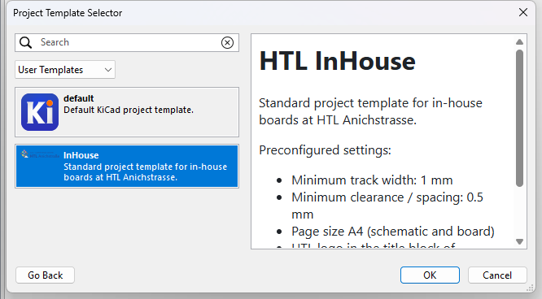
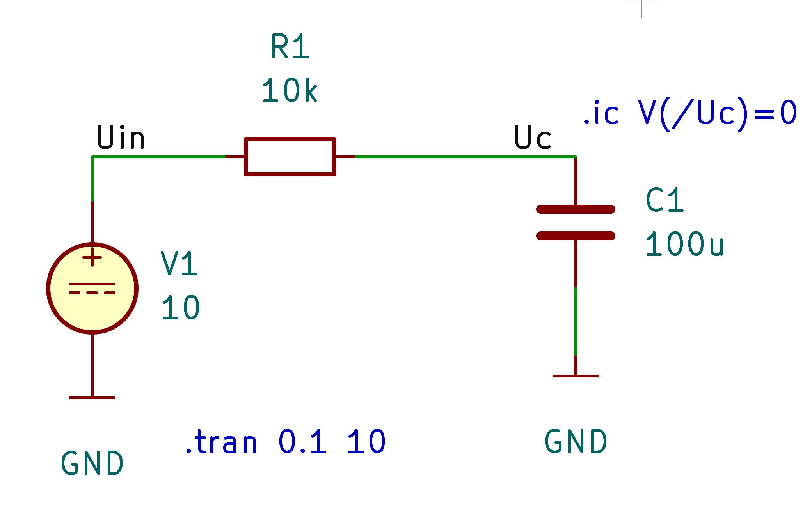
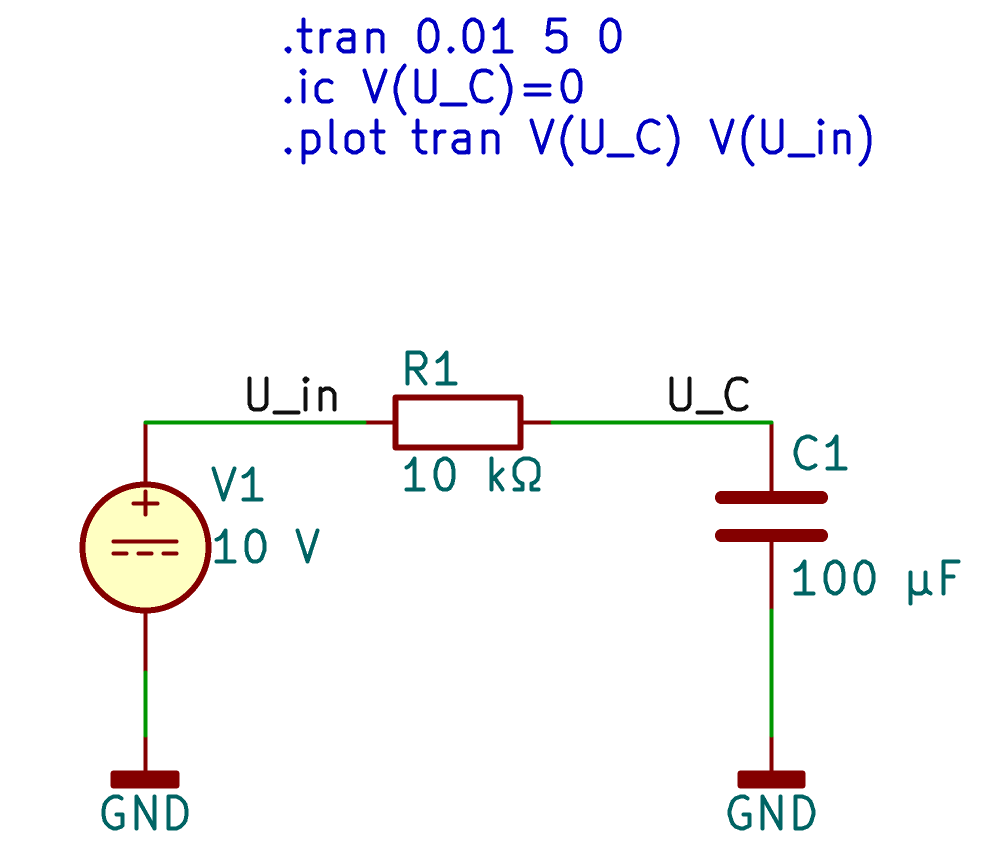
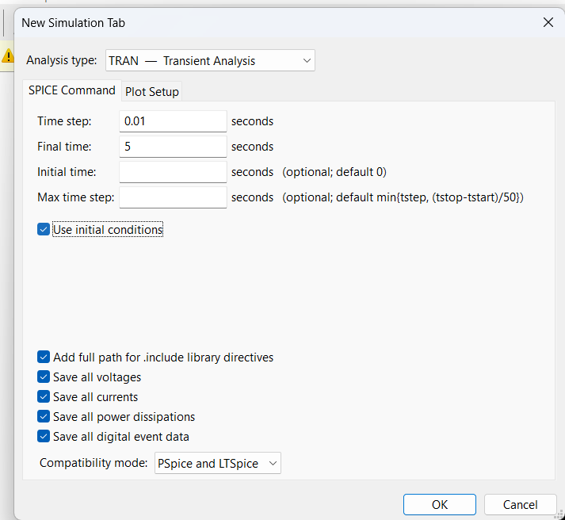
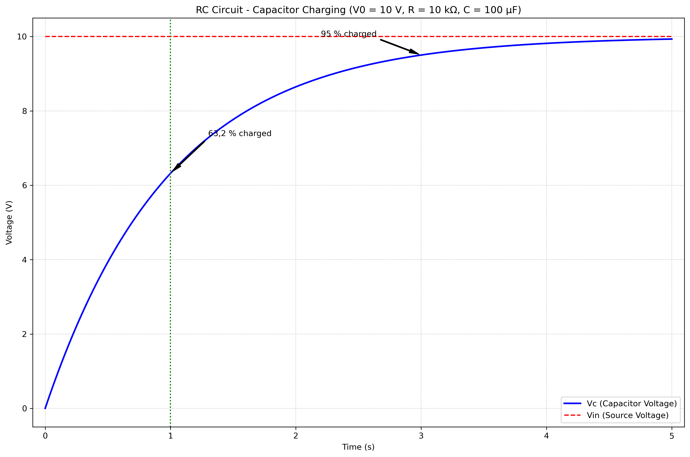
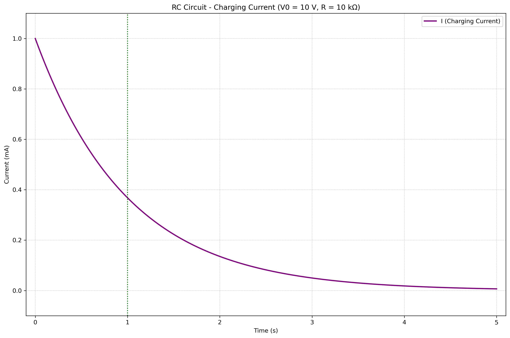

In diesem Beitrag simulieren wir eine einfache **RC-Schaltung (Widerstand-Kondensator)**
mit dem eingebauten **ngspice**-Simulator und untersuchen die Ladung des Kondensators.

::: callout-important
### Wir arbeiten mit dem InHouse-Plug-in
Diese Anleitung nutzt **ausschließlich die Bauteile aus dem InHouse-Plug-in** und das Projekt wird mit der **InHouse-Vorlage** angelegt. Falls noch nicht geschehen: [InHouse-Plug-in installieren](/posts/02-kicad-inhouse-plugin/) – dort steht auch, wie du die Standard-Bibliotheken deaktivierst, sodass nur die InHouse-Bauteile erscheinen.
:::

## Was du lernst

- Eine RC-Schaltung in KiCad erstellen  
- Die Simulation einrichten und durchführen  
- Den Ladungsverlauf des Kondensators analysieren  
- Die Zeitkonstante verstehen und berechnen

## Voraussetzungen

- KiCad 10 installiert (siehe [Installationsguide](/posts/01-kicad-installation/))
- **InHouse-Plug-in** installiert (siehe [InHouse-Plug-in installieren](/posts/02-kicad-inhouse-plugin/))
- InHouse-Bibliotheken eingerichtet (siehe [Eigene Bibliotheken als Plug-in installieren](/posts/03-kicad-bibliotheken-als-plugin/))

## Schritt 1: Neues Projekt anlegen

1. **File → New Project from Template…**, wähle die **InHouse Template**
2. Name: `rc-simulation`, Speicherort wählen
3. Öffne den **Schaltplan-Editor (Eeschema)** über den Projektmanager



## Schritt 2: RC-Schaltung aufbauen

Alle Symbole kommen aus der **InHouse-Symbolbibliothek** – im Dialog **Symbol wählen (Choose Symbol)** (**A**) erscheinen ohnehin nur noch die InHouse-Bauteile.

1. **Spannungsquelle (VDC):** platzieren, **Value = $10\, \text{V}$**
2. **Widerstand (R):** in Reihe, **Value = $10\, \text{kΩ}$**
3. **Kondensator (C):** parallel zu GND, **Value = $100\, \text{µF}$**
4. **GND (Masse):** ans untere Ende

### Verbindung herstellen

Mit dem **Wire-Tool (W)** verbinden:

- Quelle (+) → Widerstand → Kondensator
- Kondensator und Quelle (−) → GND

Deine Schaltung sollte so aussehen:



::: callout-tip
### Tipp: Netznamen zuweisen
Setze mit dem **Label-Tool (L)** die Netznamen **$U_C$** (zwischen Widerstand und Kondensator) und **$U_{in}$** (an der Quelle).  
:::

## Schritt 3: Simulation einrichten

Es gibt zwei Methoden – wähle eine:

### Methode A: SPICE-Direktiven im Schaltplan

**Place → Add SPICE Directive** (**S**), dann einfügen:

```spice
.tran 0.01 5 0
.ic V(U_C)=0
.plot tran V(U_C) V(U_in)
```

- `.tran 0.01 5 0` – Schrittwerte $0{,}01\, \text{s}$, Dauer $5\, \text{s}$
- `.ic V(U_C)=0` – Kondensator startet entladen



### Methode B: Simulations-GUI

1. **View → Simulation → Simulation Frame**
2. **Add Signal:** `V(U_C)`, `V(U_in)`, optional `I(C1)`
3. **Simulation Settings:** Transient, Stop Time $5\, \text{s}$, Time Step $0{,}01\, \text{s}$



## Schritt 4: Simulation durchführen

▶ klicken (oder **Simulation → Run Simulation**) – das Ergebnis erscheint im Simulationsfenster.

## Schritt 5: Ergebnisse analysieren

### Spannungsverlauf am Kondensator

Exponentieller Anstieg von $0\, \text{V}$ auf $10\, \text{V}$:



### Wichtige Zeitpunkte

| Zeit in $\text{s}$ | $U_C$ in $\text{V}$ | % der Endspannung |
|----------|-------------------------|-------------------|
| 0,00     | 0,0000                  | 0,0 %             |
| 0,50     | 3,9347                  | 39,3 %            |
| **1,00** | **6,3212**              | **63,2 %**        |
| 1,50     | 7,7687                  | 77,7 %            |
| **2,00** | **8,6466**              | **86,5 %**        |
| 3,00     | 9,5021                  | 95,0 %            |
| **5,00** | **9,9326**              | **99,3 %**        |

### Zeitkonstante ($\tau$)

$$\tau = R \cdot C = 10\, \text{kΩ} \cdot 100\, \text{µF} = 1\, \text{s}$$

::: callout-note
### Wichtige Regel
Nach **1 τ (1 Sekunde)** ist der Kondensator zu **63,2 %** geladen.  
Nach **5 τ (5 Sekunden)** gilt er als vollständig geladen (**99,3 %**).  
:::

### Stromverlauf

Der Ladestrom nimmt exponentiell ab: $I_0 = \frac{U_0}{R} = 1\, \text{mA}$, nach $1\, \text{s}$ ca. $0{,}37\, \text{mA}$, nach $2\, \text{s}$ ca. $0{,}14\, \text{mA}$.



## Schritt 6: Simulation anpassen (optional)

| Widerstand ($R$) | Kapazität ($C$) | Zeitkonstante $\tau$ |
|------------------|-----------------|-----------------------|
| $10\, \text{kΩ}$ | $100\, \text{µF}$ | $1\, \text{s}$ |
| $10\, \text{kΩ}$ | $10\, \text{µF}$ | $0{,}1\, \text{s}$ |
| $100\, \text{kΩ}$ | $100\, \text{µF}$ | $10\, \text{s}$ |
| $1\, \text{kΩ}$ | $1\, \text{mF}$ | $1\, \text{s}$ |

Für schnellere Schaltungen: Stop Time $1\, \text{s}$, Time Step $0{,}001\, \text{s}$. Für langsamere: Stop Time $20\, \text{s}$, Time Step $0{,}1\, \text{s}$.

## Theorieteil: Mathematische Grundlagen

Ladespannung und Ladestrom:

$$U_C(t) = U_0 \cdot \left(1 - e^{-\frac{t}{\tau}}\right) \qquad I(t) = \frac{U_0}{R} \cdot e^{-\frac{t}{\tau}}$$

mit $U_0 = 10\, \text{V}$, $\tau = R \cdot C$.

## Tipps

::: callout-tip
### Simulation speichern
Die Simulationseinstellungen lassen sich im Simulationsfenster als `.spice`-Datei speichern (**File → Save**) und später wieder laden.
:::

::: callout-warning
### Häufige Fehler
- **Keine GND-Verbindung:** Jede Schaltung braucht einen Masseanschluss
- **Falsche Einheiten:** auf kΩ, µF, mF achten
- **Zu großer Zeitschritt:** bei schnellen Vorgängen kleinere Schritte wählen
:::

## Nächste Schritte

- **Filter-Schaltungen** simulieren (Tiefpass, Hochpass)
- **Oszillator-Schaltungen** analysieren
- **Komplexere Schaltungen** mit mehreren RC-Gliedern aufbauen

Im nächsten Beitrag wird aus dieser Simulation eine [echte Platine](/posts/05-kicad-schaltung-zu-platine/).
