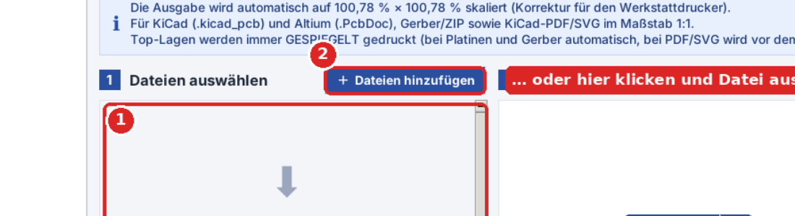
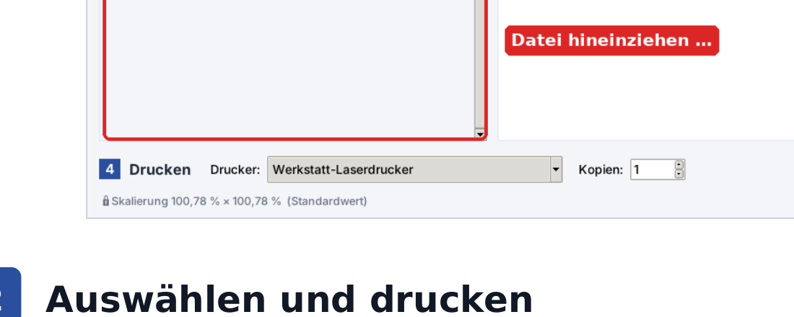
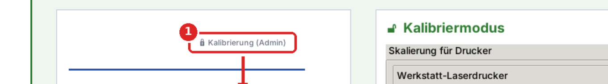

Mit der **Print Werkstätte** kannst du Platinen-Vorlagen
maßstabsgetreu auf DIN-A4 drucken.

Die Anwendung unterstützt:

- KiCad-Projekte und Leiterplatten
- Altium-Dateien
- Gerber-ZIPs
- PDF-Dateien
- SVG-Dateien

## 1. Platine ins Fenster ziehen

Ziehe die Datei in das obere Fenster der Print Werkstätte.

Warte, bis die Platinenansicht geladen ist und der Ladeindikator
vollständig verschwunden ist.

## 2. Auswählen und drucken

### Lage auswählen

Klicke in der linken Liste auf die Lage, die gedruckt werden soll.
Die große Vorschau zeigt das Ergebnis auf dem Blatt.

### Lagen ein- oder ausschalten

Schalte die einzelnen Lagen mit **Drucken an/aus** ein oder aus.
Ein grüner Schalter bedeutet, dass die Lage gedruckt wird.

Vorausgewählt sind:

- der Bestückungsplan
- das Bottom-Kupfer

Bis zu einer Platinengröße von 10 × 10 cm werden zwei Lagen
übereinander auf ein A4-Blatt gedruckt.

### Spiegeln

Bei der Lage **Top** wird die Spiegelung in der Regel automatisch
gesetzt.

Für PDF- und SVG-Dateien muss die Spiegelung zusätzlich bestätigt
werden.

### Drucker einstellen

1. Wähle den gewünschten Drucker aus.
2. Prüfe das A4-Format und die 100-%-Skalierung.
3. Klicke auf **Drucken**.

## 3. Nur bei PDF/SVG: Spiegelung bestätigen

Bei PDF- und SVG-Dateien prüfst du die Vorschau besonders sorgfältig.

::: callout-important
Auf dem Ausdruck muss die Schrift von Top-Lagen **spiegelverkehrt**
erscheinen.
:::

In der Bestätigungsansicht kannst du festlegen:

- **Ja, spiegelverkehrt - passt**
- **Nein, lesbar - jetzt spiegeln**
- **geprüft - wird gespiegelt**

Den Ausdruck startet oder brichst du mit den Schaltflächen
**Drucken** und **Abbrechen**.

## 4. Zuschneiden und aufkleben

Schneide den Ausdruck entlang der gedruckten Schnittmarken zu.

Passe das Blatt anschließend auf das Platinenrohmaterial an und klebe
es mit einem geeigneten Klebemittel fest. Das Blatt sollte glatt liegen
und darf keine Falten oder Luftblasen enthalten.

### Drucker kalibrieren

Die Kalibrierung ist nur für Lehrpersonen mit
Windows-Administratorrechten vorgesehen.

1. Öffne die **Kalibrierung (Admin)**.
2. Gib das Administratorpasswort ein.
3. Melde dich an.
4. Drucke eine Testseite mit 100 %.
5. Miss den gedruckten Rahmen.
6. Der Rahmen muss 150 × 100 mm messen.
7. Übernimm den gemessenen Wert.
8. Speichere die Kalibrierung.
9. Drucke einen Kontrolldruck.

