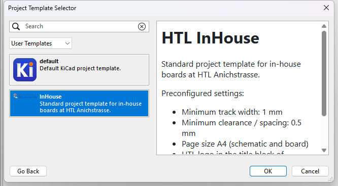
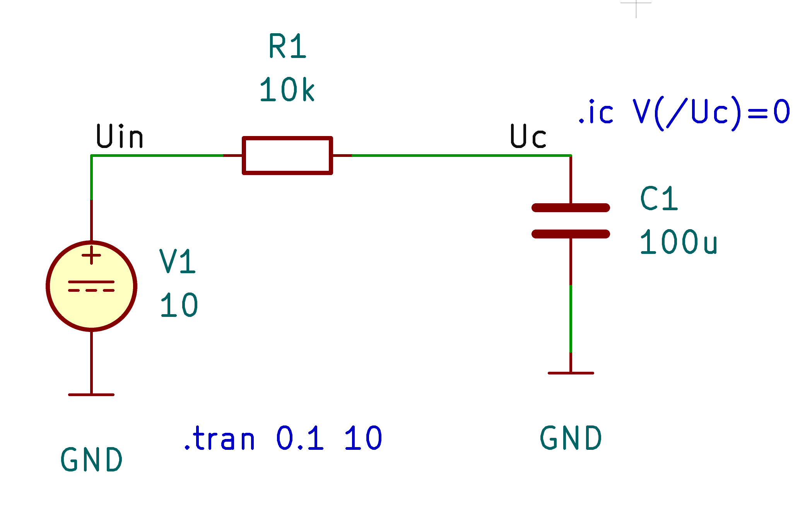
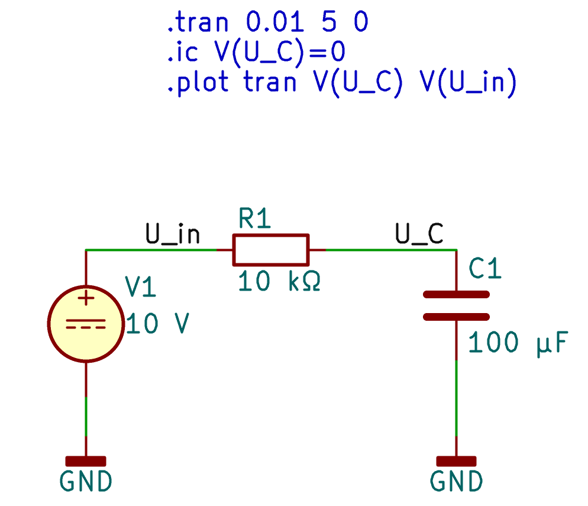
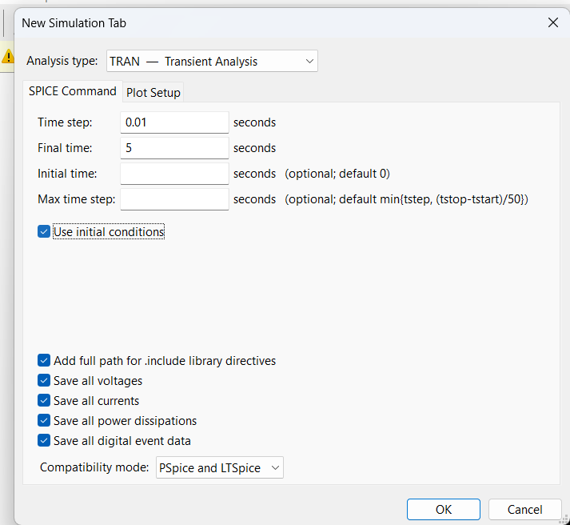
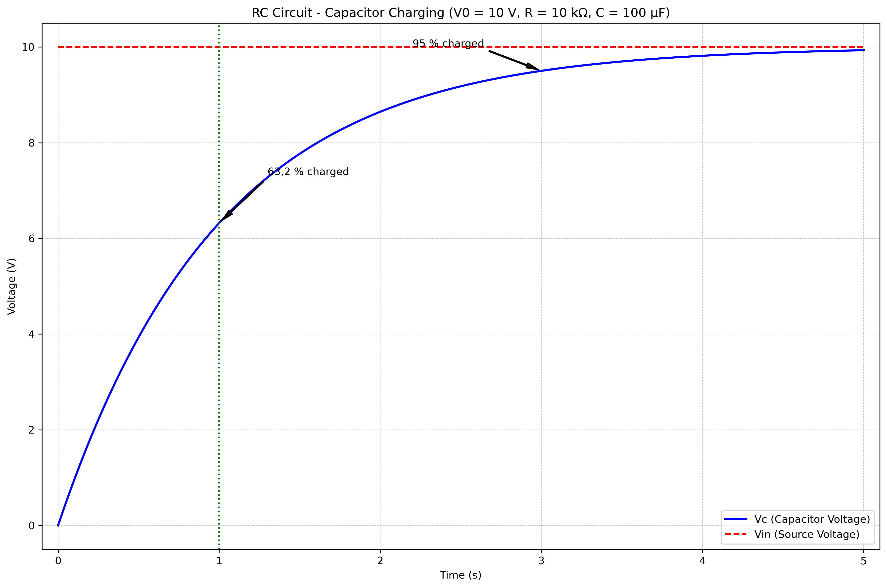
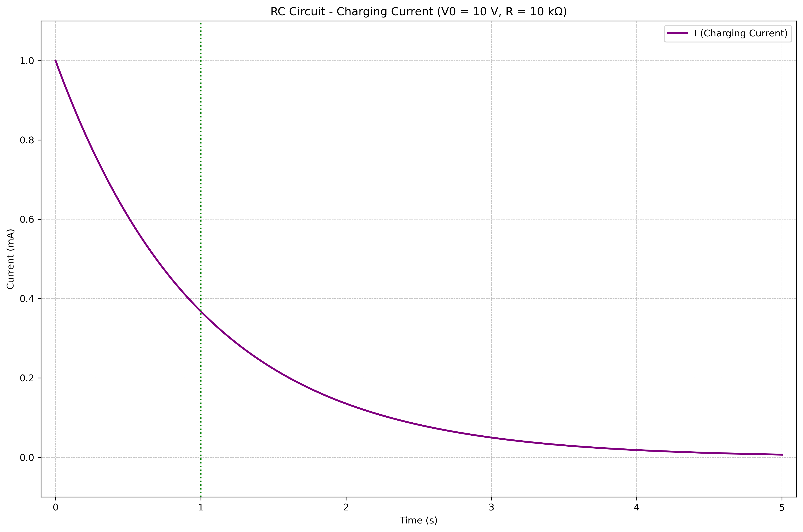

Die Simulation von Schaltungen ist einer der stärksten Vorteile von KiCad.  
Mit dem eingebauten **ngspice**-Simulator kannst du das Verhalten deiner  
Schaltungen analysieren, bevor du sie baust. In diesem Beitrag zeigen  
wir dir, wie du eine einfache **RC-Schaltung (Widerstand-Kondensator)**  
simulierst, um die Ladung eines Kondensators zu untersuchen.  

## Was du lernst

- Eine RC-Schaltung in KiCad erstellen  
- Die Simulation einrichten und durchführen  
- Den Ladungsverlauf des Kondensators analysieren  
- Die Zeitkonstante verstehen und berechnen

## Vorraussetzungen

- KiCad 10 installiert (siehe unseren [Installationsguide](/posts/2026-09-24-kicad-installation/))
- Grundlegende Kenntnisse der KiCad-Benutzeroberfläche

## Schritt 1: Neues Projekt anlegen

1. Starte **KiCad** und erstelle ein neues Projekt: **File → New Project**  
2. Vergebe einen Namen, z. B. `rc-simulation` und wähle einen Speicherort  
3. Öffne den **Schaltplan-Editor (Eeschema)** über den Projektmanager



## Schritt 2: RC-Schaltung aufbauen

### Komponenten platzieren

1. **Spannungsquelle (VDC):**
   - Klicke auf "Place → Add Symbol" (Tastatur: **A**)
   - Suche nach `VDC` oder `power` und wähle die Gleichspannungsquelle
   - Platziere sie auf dem Schaltplan
   - Doppelklick auf das Symbol und setze **Value = $10\, \text{V}$**

2. **Widerstand (R):**
   - Place → Add Symbol (A)
   - Suche nach `R` oder `Device` und wähle einen Widerstand
   - Platziere ihn neben der Spannungsquelle
   - Doppelklick und setze **Value = $10\, \text{kΩ}$**

3. **Kondensator (C):**
   - Place → Add Symbol (A)
   - Suche nach `C` oder `Device` und wähle einen Kondensator
   - Platziere ihn in Reihe mit dem Widerstand
   - Doppelklick und setze **Value = $100\, \text{µF}$**

4. **GND (Masse):**
   - Place → Add Symbol (A)
   - Suche nach `GND` und platziere ihn am unteren Ende

### Verbindung herstellen

Verwende das **Wire-Tool (W)** oder klicke auf die Pins und ziehe Verbindungen:  
- Verbinde die Spannungsquelle (+) mit dem Widerstand
- Verbinde den Widerstand mit dem Kondensator
- Verbinde den Kondensator mit GND
- Verbinde die Spannungsquelle (-) mit GND

Deine Schaltung sollte so aussehen:



::: callout-tip
### Tipp: Netznamen zuweisen
Für die Simulation ist es hilfreich, den Netzen sprechende Namen zu geben:  
- Klicke auf das **Label-Tool (L)**
- Platziere ein Label am Verbindungspunkt zwischen Widerstand und Kondensator
- Nenne es **$U_C$** (für die Kondensatorspannung)
- Benenne das Netz nach der Spannungsquelle **$U_{in}$**  
:::

## Schritt 3: Simulation einrichten

Es gibt **zwei Methoden** um die Simulation einzurichten. Wähle die, die dir lieber ist:

### Methode A: SPICE-Direktiven im Schaltplan

1. Klicke auf **Place → Add SPICE Directive** (oder Tastatur: **S**)
2. Platziere die Direktiven auf dem Schaltplan und füge folgende Zeilen ein:
   ```spice
   .tran 0.01 5 0
   .ic V(U_C)=0
   .plot tran V(U_C) V(U_in)
   ```
   - `.tran 0.01 5 0` – Transiente Analyse mit $0{,}01\, \text{s}$ Schrittweite für $5\, \text{s}$
   - `.ic V(U_C)=0` – Anfangsbedingung: $U_C = 0\, \text{V}$ (Kondensator entladen)
   - `.plot tran V(U_C) V(U_in)` – Plot $U_C$ und $U_{in}$



### Methode B: Simulations-GUI

1. Gehe zu **View → Simulation → Simulation Frame**
2. Klicke auf **Add Signal** und wähle die Signale:
   - `V(U_C)` – Spannung $U_C$ am Kondensator
   - `V(U_in)` – Eingangsspannung $U_{in}$
   - `I(C1)` – Strom $I$ durch den Kondensator (optional)

3. Unter **Simulation Settings**:
   - **Analysis Type:** Transient
   - **Stop Time:** $5\, \text{s}$
   - **Time Step:** $0{,}01\, \text{s}$



## Schritt 4: Simulation durchführen

1. Klicke auf die **Play-Schaltfläche (▶)** oder gehe zu **Simulation → Run Simulation**
2. KiCad startet ngspice und führt die Simulation durch
3. Nach einigen Sekunden erscheint das Ergebnis im Simulationsfenster

## Schritt 5: Ergebnisse analysieren

### Spannungsverlauf am Kondensator

Du solltest eine **exponentielle Kurve** sehen, die von $0\, \text{V}$ auf $10\, \text{V}$ ansteigt.



### Wichtige Zeitpunkte

| Zeit  in $\text{s}$ | $U_C$ in $\text{V}$ | % der Endspannung |
|----------|-------------------------|-------------------|
| 0,00     | 0,0000                  | 0,0 %             |
| 0,50     | 3,9347                  | 39,3 %            |
| **1,00** | **6,3212**              | **63,2 %**        |
| 1,50     | 7,7687                  | 77,7 %            |
| **2,00** | **8,6466**              | **86,5 %**        |
| 3,00     | 9,5021                  | 95,0 %            |
| **5,00** | **9,9326**              | **99,3 %**        |

### Zeitkonstante ($\tau$) verstehen

Die **Zeitkonstante** eines RC-Glieds berechnet sich nach:

$$\tau = R \cdot C$$

In unserem Beispiel:  
- $R = 10\, \text{kΩ}$  
- $C = 100\, \text{µF}$  
- $\tau = R \cdot C = 1\, \text{s}$  

::: callout-note
### Wichtige Regel
Nach **1 τ (1 Sekunde)** ist der Kondensator zu **63,2 %**geladen. 
Nach **5 τ (5 Sekunden)** gilt er als **vollständig geladen (99,3 %)**.  
:::

### Stromverlauf

Der Ladestrom folgt einer **exponentiellen Abnahme**:

- **Anfangsstrom** ($t = 0$): $I_0 = \frac{U_0}{R} = \frac{10\, \text{V}}{10\, \text{kΩ}} = 1\, \text{mA}$
- Nach $1\, \text{s}$: ca. $0{,}37\, \text{mA}$
- Nach $2\, \text{s}$: ca. $0{,}14\, \text{mA}$



## Schritt 6: Simulation anpassen (optional)

### Andere Werte ausprobieren

Ändere die Werte und beobachte, wie sich die Ladezeit ändert:  

| Widerstand ($R$) | Kapazität ($C$) | Zeitkonstante $\tau$ |
|------------------|-----------------|-----------------------|
| $10\, \text{kΩ}$ | $100\, \text{µF}$ | $1\, \text{s}$ |
| $10\, \text{kΩ}$ | $10\, \text{µF}$ | $0{,}1\, \text{s}$ |
| $100\, \text{kΩ}$ | $100\, \text{µF}$ | $10\, \text{s}$ |
| $1\, \text{kΩ}$ | $1\, \text{mF}$ | $1\, \text{s}$ |

### Simulationsdauer anpassen

Für schnellere Schaltungen (kleineres $\tau$):  
- Stop Time: $1\, \text{s}$
- Time Step: $0{,}001\, \text{s}$

Für langsamere Schaltungen (größeres $\tau$):  
- Stop Time: $20\, \text{s}$
- Time Step: $0{,}1\, \text{s}$

## Theorieteil: Mathematische Grundlagen

### Ladespannung

Die Spannung am Kondensator während des Ladevorgangs folgt der Formel:

$$U_C(t) = U_0 \cdot \left(1 - e^{-\frac{t}{\tau}}\right)$$

- $U_C(t)$ = Spannung am Kondensator zur Zeit $t$
- $U_0 = 10\, \text{V}$ = Versorgungsspannung
- $t$ = Zeit in $\text{s}$
- $\tau$ = Zeitkonstante ($R \cdot C$)

### Ladestrom

Der Strom während des Ladevorgangs:

$$I(t) = \frac{U_0}{R} \cdot e^{-\frac{t}{\tau}}$$

## Tipps und Tricks

::: callout-tip
### Simulation speichern
- Die Simulations-Einstellungen werden in einer `.spice`-Datei gespeichert
- Du kannst diese unter **File → Save** im Simulationsfenster speichern
- So kannst du die Simulation später schnell wieder laden
:::

::: callout-warning
### Häufige Fehler
- **Keine GND-Verbindung:** Jede Schaltung braucht einen Masseanschluss
- **Falsche Werte:** Achte auf die Einheit (kΩ, µF, mF etc.)
- **Zu großer Zeitschritt:** Bei schnellen Vorgängen kleinere Schritte wählen
:::

## Nächste Schritte

Jetzt, wo du die Grundlagen der RC-Simulation beherrschst, kannst du:

- **Filter-Schaltungen** simulieren (Tiefpass, Hochpass)
- **Oszillator-Schaltungen** analysieren
- **Komplexere Schaltungen** mit mehreren RC-Gliedern aufbauen

Viel Erfolg beim Experimentieren mit KiCad-Simulationen!
